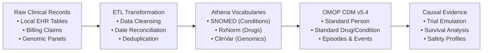

# Health Data Reimagined: The OMOP CDM Architecture

**Transforming fragmented hospital records into verifiable global evidence.**

**Lead Engineer:** [Harish Mohankumar](https://github.com/harishedu11-hash)
**Platform:** OMOP CDM v5.4 · PostgreSQL 16 · OHDSI ATLAS / WebAPI 2.13.0 · HADES (R)

---

## Overview

Clinical records live in hundreds of incompatible dialects across thousands of hospitals. This project builds an **OMOP Common Data Model** foundation that turns disconnected patient records into reproducible clinical insights.

### The Problem

The same diagnosis, such as "Type 2 Diabetes", is stored differently everywhere: an ICD-10 code in Boston, a read-code in London, free-text narrative in Munich. When leaders need an answer, such as *"Does Medication A protect diabetic patients from kidney failure better than Medication B?"*, engineers spend months per site cleaning and reconciling data.

### The Solution: A Shipping Container for Health Data

Just as the intermodal shipping container standardized global trade, the OMOP CDM, maintained by the [OHDSI](https://www.ohdsi.org/) community, standardizes health data in two ways:

1. **Structural standardization:** every patient, encounter, prescription, diagnosis, and lab result lives in the same tables with identical columns, everywhere.
2. **Semantic standardization:** messy local codes and brand names map to a single concept ID. "Glucophage", "Metformin Hydrochloride", and international brand names all resolve to `1503297`.

---

## Pipeline: Raw Data to Causal Answers

1. **Raw records:** claims, visits, and lab panels arrive in disparate formats.
2. **ETL cleansing:** pipelines validate date chronologies, remove duplicates, and structure inputs.
3. **Vocabulary harmonization:** Athena dictionaries map raw strings to certified clinical concepts.
4. **OMOP database:** data is persisted in PostgreSQL under standard integrity rules.
5. **Reproducible analytics:** HADES packages evaluate causal questions and safety metrics.

---

## Platform Results & ATLAS Cohort Mapping

Verified on a containerized OHDSI ATLAS and WebAPI environment:

| Cohort ID | Cohort Name           | Role                   | Standard Concept ID | Vocabulary     | Verified Records     |
| --------- | --------------------- | ---------------------- | ------------------- | -------------- | -------------------- |
| **101**   | Metformin Monotherapy | Target Cohort (T)      | `1503297`           | RxNorm         | 47 Patients          |
| **102**   | Insulin Initiation    | Comparator Cohort (C)  | `1596977`           | RxNorm         | 15 Patients          |
| **103**   | Severe Hypoglycemia   | Primary Safety Outcome | `432961`            | SNOMED         | 38 Events            |
| **104**   | Diabetic Nephropathy  | Microvascular Endpoint | `4055665`           | SNOMED         | 29 Events            |
| **201**   | NSCLC Disease Course  | Parent Cancer Episode  | `4115276`           | SNOMED / mCODE | 14 Patients (28 Ep.) |

---

## Business Payoff

**Months to hours: time-to-evidence acceleration.** Once data is in the OMOP CDM, new epidemiological studies run on validated network packages instead of custom SQL engineering.

- **Collaborative research without data transfer:** join multi-center studies with millions of patient records without sharing patient-level rows, respecting GDPR and HIPAA boundaries.
- **Audit-proof data governance:** the OHDSI Data Quality Dashboard (DQD) enforces thousands of consistency, plausibility, and completeness checks.
- **Reusable analytical assets:** trial emulations, cohort phenotypes, and survival analyses are version-controlled code that reruns on future database refreshes.

---

## Explore the Implementations

| Case | Focus | Highlights |
| ---- | ----- | ---------- |
| [Case 1: Architecture](https://harishedu11-hash.github.io/omop-showcase/implementation-1.html) | Architecture & zero-cost views | Multi-schema vocabulary federation without duplicating 10M+ dictionary rows |
| [Case 2: Causal Trial](https://harishedu11-hash.github.io/omop-showcase/implementation-2.html) | Causal trial emulation | Diagnosed an extreme positivity violation; 100% patient retention via propensity score stratification |
| [Case 3: Precision Oncology](https://harishedu11-hash.github.io/omop-showcase/implementation-3.html) | Precision oncology & genomics | 235.6 patient-years of biomarker-stratified lung cancer journeys using OMOP v5.4 `EPISODE` tables |

See also the [Glossary](https://harishedu11-hash.github.io/omop-showcase/glossary.html) for OMOP and OHDSI terminology.

---

## Tech Stack

- **Data model:** OMOP CDM v5.4
- **Database:** PostgreSQL 16
- **Vocabularies:** OHDSI Athena (SNOMED, RxNorm, ClinVar)
- **Cohorts & tooling:** OHDSI ATLAS, WebAPI 2.13.0
- **Analytics:** HADES (R)
- **Data quality:** OHDSI Data Quality Dashboard (DQD)
- **Showcase site:** Quarto

---

## Author

**Harish Mohankumar**: Health Data Engineering
GitHub: [@harishedu11-hash](https://github.com/harishedu11-hash)
Showcase: [harishedu11-hash.github.io/omop-showcase](https://harishedu11-hash.github.io/omop-showcase/)
